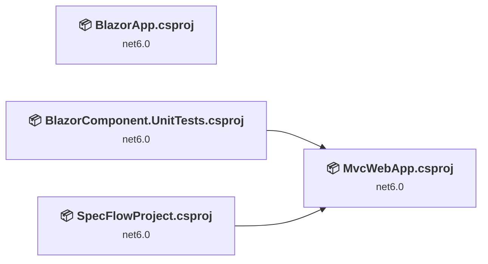
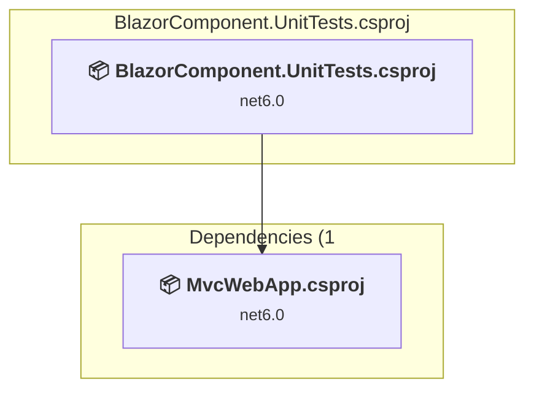
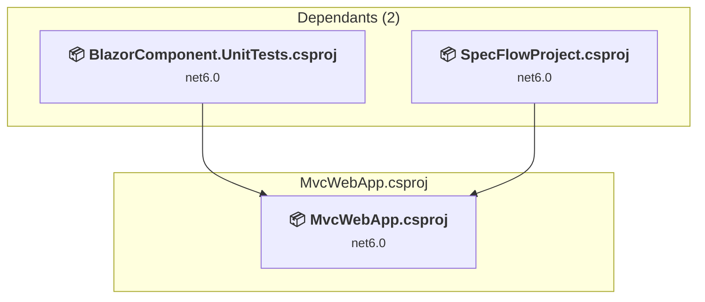
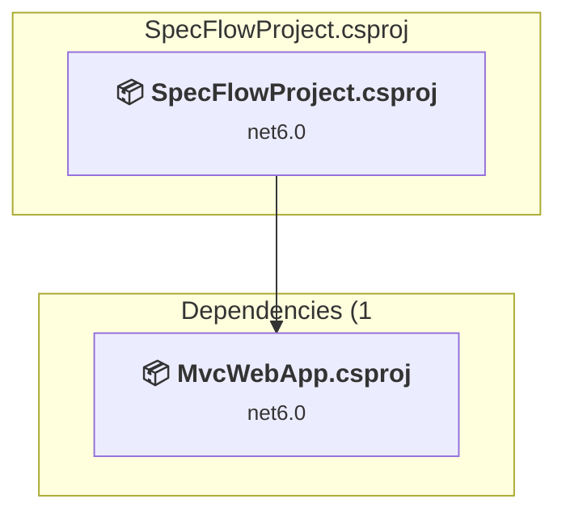
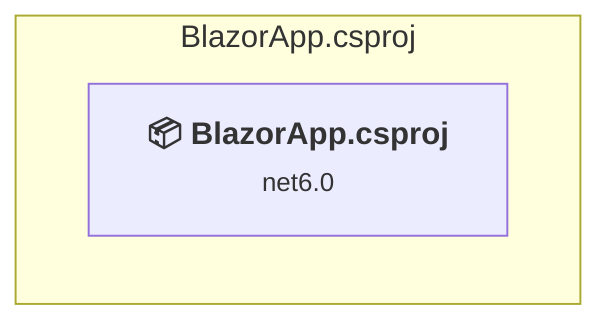

# Projects and dependencies analysis

This document provides a comprehensive overview of the projects and their dependencies in the context of upgrading to .NETCoreApp,Version=v10.0.

## Table of Contents

- [Executive Summary](#executive-Summary)
  - [Highlevel Metrics](#highlevel-metrics)
  - [Projects Compatibility](#projects-compatibility)
  - [Package Compatibility](#package-compatibility)
  - [API Compatibility](#api-compatibility)
  - [Binding Redirect Configuration](#binding-redirect-configuration)
- [Aggregate NuGet packages details](#aggregate-nuget-packages-details)
- [Top API Migration Challenges](#top-api-migration-challenges)
  - [Technologies and Features](#technologies-and-features)
  - [Most Frequent API Issues](#most-frequent-api-issues)
- [Projects Relationship Graph](#projects-relationship-graph)
- [Project Details](#project-details)

  - [BlazorComponent.Tests\BlazorComponent.UnitTests.csproj](#blazorcomponenttestsblazorcomponentunittestscsproj)
  - [MvcWebApp\MvcWebApp.csproj](#mvcwebappmvcwebappcsproj)
  - [SpecFlowProject\SpecFlowProject.csproj](#specflowprojectspecflowprojectcsproj)
  - [TodoList\BlazorApp.csproj](#todolistblazorappcsproj)

## Executive Summary

### Highlevel Metrics

| Metric | Count | Status |
| :--- | :---: | :--- |
| Total Projects | 4 | All require upgrade |
| Total NuGet Packages | 12 | 5 need upgrade |
| Total Code Files | 31 |  |
| Total Code Files with Incidents | 6 |  |
| Total Lines of Code | 916 |  |
| Total Number of Issues | 12 |  |
| Estimated LOC to modify | 2+ | at least 0.2% of codebase |

### Projects Compatibility

| Project | Target Framework | Difficulty | Package Issues | API Issues | Binding Issues | Est. LOC Impact | Description |
| :--- | :---: | :---: | :---: | :---: | :---: | :---: | :--- |
| [BlazorComponent.Tests\BlazorComponent.UnitTests.csproj](#blazorcomponenttestsblazorcomponentunittestscsproj) | net6.0 | 🟢 Low | 1 | 0 | 0 |  | DotNetCoreApp, Sdk Style = True |
| [MvcWebApp\MvcWebApp.csproj](#mvcwebappmvcwebappcsproj) | net6.0 | 🟢 Low | 0 | 1 | 0 | 1+ | AspNetCore, Sdk Style = True |
| [SpecFlowProject\SpecFlowProject.csproj](#specflowprojectspecflowprojectcsproj) | net6.0 | 🟢 Low | 5 | 0 | 0 |  | DotNetCoreApp, Sdk Style = True |
| [TodoList\BlazorApp.csproj](#todolistblazorappcsproj) | net6.0 | 🟢 Low | 0 | 1 | 0 | 1+ | AspNetCore, Sdk Style = True |

### Package Compatibility

| Status | Count | Percentage |
| :--- | :---: | :---: |
| ✅ Compatible | 7 | 58.3% |
| ⚠️ Incompatible | 4 | 33.3% |
| 🔄 Upgrade Recommended | 1 | 8.3% |
| ***Total NuGet Packages*** | ***12*** | ***100%*** |

### API Compatibility

| Category | Count | Impact |
| :--- | :---: | :--- |
| 🔴 Binary Incompatible | 0 | High - Require code changes |
| 🟡 Source Incompatible | 0 | Medium - Needs re-compilation and potential conflicting API error fixing |
| 🔵 Behavioral change | 2 | Low - Behavioral changes that may require testing at runtime |
| ✅ Compatible | 3437 |  |
| ***Total APIs Analyzed*** | ***3439*** |  |

## Aggregate NuGet packages details

| Package | Current Version | Suggested Version | Projects | Description |
| :--- | :---: | :---: | :--- | :--- |
| bunit | 1.9.8 |  | [BlazorComponent.UnitTests.csproj](#blazorcomponenttestsblazorcomponentunittestscsproj) | ✅Compatible |
| coverlet.collector | 3.1.2 |  | [BlazorComponent.UnitTests.csproj](#blazorcomponenttestsblazorcomponentunittestscsproj) | ✅Compatible |
| FluentAssertions | 6.7.0 |  | [SpecFlowProject.csproj](#specflowprojectspecflowprojectcsproj) | ✅Compatible |
| Microsoft.Extensions.Hosting.Abstractions | 6.0.0 | 10.0.10 | [SpecFlowProject.csproj](#specflowprojectspecflowprojectcsproj) | NuGet package upgrade is recommended |
| Microsoft.NET.Test.Sdk | 17.2.0 |  | [BlazorComponent.UnitTests.csproj](#blazorcomponenttestsblazorcomponentunittestscsproj) [SpecFlowProject.csproj](#specflowprojectspecflowprojectcsproj) | ✅Compatible |
| MudBlazor | 5.2.0 |  | [MvcWebApp.csproj](#mvcwebappmvcwebappcsproj) | ✅Compatible |
| Selenium.WebDriver.ChromeDriver | 102.0.5005.6102 |  | [SpecFlowProject.csproj](#specflowprojectspecflowprojectcsproj) | ✅Compatible |
| SpecFlow.Actions.Selenium | 0.1.332 |  | [SpecFlowProject.csproj](#specflowprojectspecflowprojectcsproj) | ⚠️NuGet package is deprecated |
| SpecFlow.Plus.LivingDocPlugin | 3.9.57 |  | [SpecFlowProject.csproj](#specflowprojectspecflowprojectcsproj) | ⚠️NuGet package is deprecated |
| SpecFlow.xUnit | 3.9.74 |  | [SpecFlowProject.csproj](#specflowprojectspecflowprojectcsproj) | ⚠️NuGet package is deprecated |
| xunit | 2.4.1 |  | [BlazorComponent.UnitTests.csproj](#blazorcomponenttestsblazorcomponentunittestscsproj) [SpecFlowProject.csproj](#specflowprojectspecflowprojectcsproj) | ⚠️NuGet package is deprecated |
| xunit.runner.visualstudio | 2.4.5 |  | [BlazorComponent.UnitTests.csproj](#blazorcomponenttestsblazorcomponentunittestscsproj) [SpecFlowProject.csproj](#specflowprojectspecflowprojectcsproj) | ✅Compatible |

## Top API Migration Challenges

### Technologies and Features

| Technology | Issues | Percentage | Migration Path |
| :--- | :---: | :---: | :--- |

### Most Frequent API Issues

| API | Count | Percentage | Category |
| :--- | :---: | :---: | :--- |
| M:Microsoft.AspNetCore.Builder.ExceptionHandlerExtensions.UseExceptionHandler(Microsoft.AspNetCore.Builder.IApplicationBuilder,System.String) | 2 | 100.0% | Behavioral Change |

## Projects Relationship Graph

Legend:
📦 SDK-style project
⚙️ Classic project

## Project Details

### BlazorComponent.Tests\BlazorComponent.UnitTests.csproj

#### Project Info

- **Current Target Framework:** net6.0
- **Proposed Target Framework:** net10.0
- **SDK-style**: True
- **Project Kind:** DotNetCoreApp
- **Dependencies**: 1
- **Dependants**: 0
- **Number of Files**: 5
- **Number of Files with Incidents**: 1
- **Lines of Code**: 18
- **Estimated LOC to modify**: 0+ (at least 0.0% of the project)

#### Dependency Graph

Legend:
📦 SDK-style project
⚙️ Classic project

### API Compatibility

| Category | Count | Impact |
| :--- | :---: | :--- |
| 🔴 Binary Incompatible | 0 | High - Require code changes |
| 🟡 Source Incompatible | 0 | Medium - Needs re-compilation and potential conflicting API error fixing |
| 🔵 Behavioral change | 0 | Low - Behavioral changes that may require testing at runtime |
| ✅ Compatible | 13 |  |
| ***Total APIs Analyzed*** | ***13*** |  |

### MvcWebApp\MvcWebApp.csproj

#### Project Info

- **Current Target Framework:** net6.0
- **Proposed Target Framework:** net10.0
- **SDK-style**: True
- **Project Kind:** AspNetCore
- **Dependencies**: 0
- **Dependants**: 2
- **Number of Files**: 23
- **Number of Files with Incidents**: 2
- **Lines of Code**: 252
- **Estimated LOC to modify**: 1+ (at least 0.4% of the project)

#### Dependency Graph

Legend:
📦 SDK-style project
⚙️ Classic project

### API Compatibility

| Category | Count | Impact |
| :--- | :---: | :--- |
| 🔴 Binary Incompatible | 0 | High - Require code changes |
| 🟡 Source Incompatible | 0 | Medium - Needs re-compilation and potential conflicting API error fixing |
| 🔵 Behavioral change | 1 | Low - Behavioral changes that may require testing at runtime |
| ✅ Compatible | 1810 |  |
| ***Total APIs Analyzed*** | ***1811*** |  |

### SpecFlowProject\SpecFlowProject.csproj

#### Project Info

- **Current Target Framework:** net6.0
- **Proposed Target Framework:** net10.0
- **SDK-style**: True
- **Project Kind:** DotNetCoreApp
- **Dependencies**: 1
- **Dependants**: 0
- **Number of Files**: 11
- **Number of Files with Incidents**: 1
- **Lines of Code**: 426
- **Estimated LOC to modify**: 0+ (at least 0.0% of the project)

#### Dependency Graph

Legend:
📦 SDK-style project
⚙️ Classic project

### API Compatibility

| Category | Count | Impact |
| :--- | :---: | :--- |
| 🔴 Binary Incompatible | 0 | High - Require code changes |
| 🟡 Source Incompatible | 0 | Medium - Needs re-compilation and potential conflicting API error fixing |
| 🔵 Behavioral change | 0 | Low - Behavioral changes that may require testing at runtime |
| ✅ Compatible | 346 |  |
| ***Total APIs Analyzed*** | ***346*** |  |

### TodoList\BlazorApp.csproj

#### Project Info

- **Current Target Framework:** net6.0
- **Proposed Target Framework:** net10.0
- **SDK-style**: True
- **Project Kind:** AspNetCore
- **Dependencies**: 0
- **Dependants**: 0
- **Number of Files**: 35
- **Number of Files with Incidents**: 2
- **Lines of Code**: 220
- **Estimated LOC to modify**: 1+ (at least 0.5% of the project)

#### Dependency Graph

Legend:
📦 SDK-style project
⚙️ Classic project

### API Compatibility

| Category | Count | Impact |
| :--- | :---: | :--- |
| 🔴 Binary Incompatible | 0 | High - Require code changes |
| 🟡 Source Incompatible | 0 | Medium - Needs re-compilation and potential conflicting API error fixing |
| 🔵 Behavioral change | 1 | Low - Behavioral changes that may require testing at runtime |
| ✅ Compatible | 1268 |  |
| ***Total APIs Analyzed*** | ***1269*** |  |

